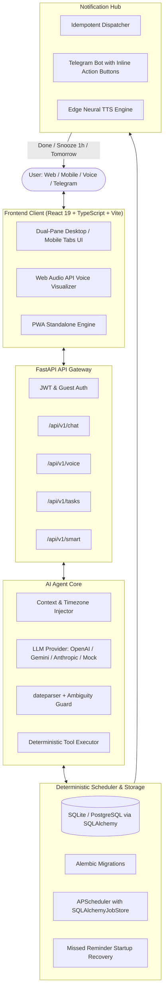

#  TaskMind — AI Task-Remember Agent

> **An intelligent, full-stack AI task assistant where you speak or chat in natural language, and a strictly deterministic scheduler guarantees on-time reminders and execution.**

[](https://www.python.org/)
[](https://fastapi.tiangolo.com/)
[](https://react.dev/)
[](https://www.typescriptlang.org/)
[](https://tailwindcss.com/)
[]()
[]()

---

## 🧠 Core Architectural Principle

```
+-----------------------------------------------------------------------------------------+
|                                    CORE INVARIANT                                       |
|                                                                                         |
|   The Large Language Model (LLM) is ONLY used to parse human intent and call tools.      |
|   All dates, deadlines, time arithmetic, recurrence rules, and notification timings     |
|   are executed strictly by the deterministic backend engine and persistent scheduler.   |
|   NO REMINDERS OR DEADLINES ARE EVER HALLUCINATED.                                      |
+-----------------------------------------------------------------------------------------+
```

---

## 🏛️ System Architecture



---

## ✨ Features

### 1. 💬 Natural Language Task Management
- Add, search, update, snooze, and complete tasks using natural phrasing:
  - *"Remind me to submit the Q3 tax return tomorrow at 5pm urgent in Work"*
  - *"What are my top priorities today?"*
  - *"Snooze task 5 for 2 hours"*
  - *"Drink water every 2 hours starting at 9am"*
- Multi-turn conversation sessions with safety confirmation guards for destructive operations (e.g., deleting tasks).

### 2. 🎙️ Voice Interface (Speech-to-Text & Neural TTS)
- **Speech-to-Text (STT)**: High-precision transcription via **OpenAI Whisper** and **Groq Whisper** with offline fallback.
- **Text-to-Speech (TTS)**: Realistic speech synthesis powered by **Microsoft Edge Neural Voices** (`en-US-JennyNeural`, `en-US-GuyNeural`, `en-US-AriaNeural`, `en-GB-SoniaNeural`, `en-IN-NeerjaNeural`).
- **Web Audio Waveform**: Real-time microphone audio visualizer with animated ripple pulses and barge-in audio playback.
- **Spoken Text Optimization**: Automatically cleans Markdown tags and limits verbal replies to $\le 2$ concise sentences.

### 3. ⏰ Deterministic Scheduling & Notifications
- Persistent **APScheduler** backend with database-backed job store (`apscheduler_jobs` table).
- **Atomic Idempotency**: Atomic state locking prevents duplicate reminders across multiple scheduler ticks or server restarts.
- **Startup Recovery Sweep**: Automatically detects and catches up any reminders that matured while the server was offline.
- **Telegram Bot**: Sends rich notifications directly to your phone with interactive inline buttons (`✅ Done`, `⏳ Snooze 1h`, `📅 Tomorrow`).

### 4. 🧠 Smart Productivity Features
- **Recurrence Engine**: Full RFC-5545 **RRULE** compliance (daily, weekly, custom intervals) with automatic spawning of subsequent task instances upon completion.
- **Escalating Reminders**: Multi-tiered notifications that escalate in frequency for unacknowledged high-priority tasks.
- **Workload Capacity Analysis**: Proactively detects overload (>6 hours estimated or >8 tasks in a day) and suggests deferrals.
- **Morning Intelligence Briefing**: Summarizes your daily commitments and highlights urgent deadlines.
- **Weekly Productivity Review**: 7-day retrospective analytics, on-time completion rates, and category distribution breakdowns.

### 5. 🎨 Modern Web App & PWA
- **Aesthetic Design**: Clean White background (`#FFFFFF`), light-gray surfaces (`#F3F4F6`), subtle borders (`#E5E7EB`), dark typography (`#111827`), and deep Indigo accents (`#4F46E5`).
- **Responsive Dual-Pane**: Left sidebar and dual-pane layout on desktop; tab navigation with floating action buttons on mobile.
- **Micro-Interactions**: Confetti celebration particles upon task completion.
- **PWA Ready**: Installable on iOS, Android, and Desktop via Web App Manifest.
- **Global Shortcuts**: Press `N` for new task modal; press `/` to focus search.

---

## 🗂️ Project Structure

```
TaskMind app/
├── backend/
│   ├── alembic/                  # Database migration scripts
│   ├── app/
│   │   ├── agent/                # LLM providers, prompts, date parser, tool executor
│   │   ├── api/v1/endpoints/     # FastAPI route handlers (tasks, chat, voice, smart, auth)
│   │   ├── auth/                 # JWT security & user authentication
│   │   ├── crud/                 # Database CRUD operations
│   │   ├── models/               # SQLAlchemy ORM models (User, Task, Reminder, TaskEvent)
│   │   ├── notifications/        # Telegram Bot & Notification Dispatcher
│   │   ├── scheduler/            # APScheduler persistent engine & reminder service
│   │   ├── schemas/              # Pydantic validation schemas
│   │   ├── smart/                # Recurrence, escalation, overload & briefings
│   │   └── voice/                # Whisper STT, Edge TTS & voice pipeline
│   ├── tests/                    # 64 automated pytest test cases
│   ├── requirements.txt
│   └── Dockerfile
├── frontend/
│   ├── public/                   # Manifest, icons, and static assets
│   ├── src/
│   │   ├── assets/               # Official logo and branding
│   │   ├── components/           # UI components (tasks, chat, voice, calendar, stats, layout)
│   │   ├── context/              # Auth context with auto-guest fallback
│   │   ├── hooks/                # Voice recorder, keyboard shortcuts, PWA install
│   │   ├── services/             # Axios API client (tasks, chat, voice, smart, auth)
│   │   ├── types/                # TypeScript type definitions
│   │   └── views/                # Dashboard, Calendar, Stats, Settings, Chat views
│   ├── package.json
│   ├── nginx.conf
│   └── Dockerfile
├── docker-compose.yml            # Development Docker Compose
├── docker-compose.prod.yml       # Production Multi-Container Compose
└── README.md
```

---

## 🚀 Quick Start (Local Setup)

### Prerequisites
- Python 3.11+
- Node.js 20+ & npm
- Git

### 1. Clone & Configure Environment

```bash
git clone https://github.com/your-repo/taskmind.git
cd taskmind

# Copy sample environment configuration
cp .env.example .env
```

Edit `.env` to configure your preferred LLM provider (`mock`, `openai`, `gemini`, `anthropic`, or `groq`) and Telegram Bot token.

### 2. Start Backend API

```bash
cd backend
python -m venv venv

# Windows:
venv\Scripts\activate
# Linux/macOS:
source venv/bin/activate

pip install -r requirements.txt
alembic upgrade head
python -m uvicorn app.main:app --reload --port 8000
```

Backend API will be running at `http://127.0.0.1:8000` with interactive Swagger docs at `http://127.0.0.1:8000/docs`.

### 3. Start Frontend App

```bash
cd ../frontend
npm install
npm run dev
```

Frontend application will open at `http://localhost:5173/`.

---

## 🐳 Docker Deployment

### Run with Production Docker Compose

```bash
docker-compose -f docker-compose.prod.yml up --build -d
```

- Web Application & Reverse Proxy: `http://localhost`
- Backend API: `http://localhost/api/v1`

---

## 🧪 Automated Testing & Evaluation Benchmarks

TaskMind includes a comprehensive test suite of **64 automated tests** covering database models, cross-database UTC serialization, agent tool execution, reminder idempotency, smart recurrence calculations, voice pipelines, and a **30-sentence real-world benchmark evaluation**.

Run the test suite:

```bash
cd backend
python -m pytest -v
```

```
============================== test session starts ==============================
collected 64 items

tests/test_chat_endpoint.py ......................... [  5%]
tests/test_eval_sentences.py (30 benchmark sentences) [ 55%] (100% pass)
tests/test_health.py ................................ [ 59%]
tests/test_models.py ................................ [ 62%]
tests/test_reminders_scheduler.py ................... [ 74%]
tests/test_smart_features.py ........................ [ 85%]
tests/test_tasks_crud.py ............................ [ 92%]
tests/test_voice.py ................................. [100%]

======================== 64 passed, 1 warning in 4.91s ==========================
```

---

## 🤖 Telegram Bot Integration

1. Message [@BotFather](https://t.me/BotFather) on Telegram and create a new bot to obtain your bot token.
2. Add the token to `.env`:
   ```env
   TELEGRAM_BOT_TOKEN="123456789:ABCdefGHIjklMNOpqrsTUVwxyz"
   ```
3. Open Telegram, search for your bot, and send `/start`.
4. Your account is instantly linked to receive scheduled notifications with interactive callback buttons.

---

## 📄 License

MIT License — free for personal and commercial use.
